::: {.callout-note appearance="simple"}
**À propos de ce document.** Cette page réunit, dans l'ordre chronologique de la présentation,
le contenu théorique de l'atelier **et** les exercices pratiques qui l'entrecoupent.

Les données géospatiales (géodatabases, `.aprx`, etc.) ne sont pas incluses ici.

Les emplacements marqués **« IMAGE À REMPLACER »** correspondent à des captures d'écran, logos
ou photos susceptibles de poser un problème de droits d'auteur (interfaces ESRI, logos
d'applications, photos de produits, etc.). Ce sont des *spots vides* : chaque légende décrit
précisément le visuel attendu, à remplacer par une image dont vous détenez les droits.
:::

# Introduction {#sec-intro}

## Présentateurs {#sec-presentateurs}

### Hugues Dorion

- B.Sc. Géographie physique et environnements naturels — U. Laval
- M.Sc. Sciences géographiques — U. Laval
- Technicien forestier & analyste d'images satellitaires et de données spatiales — Ress. Nat. Canada & U. Laval (2014–2020)
- Planteur d'arbres, pompier forestier, abatteur manuel, construction de sentiers, analyste de feux de forêts (2020–2024)
- Professionnel de recherche en télédétection & analyse spatiale — Centre d'étude de la forêt, UQAC (2024–…)
- ✉️ [hdorion@uqac.ca](mailto:hdorion@uqac.ca)

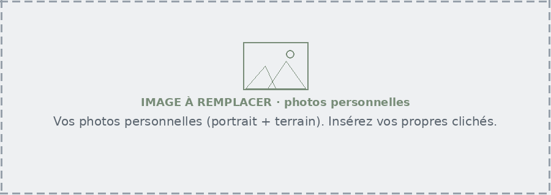

### Mélanie Desrochers

- B.Sc. Géographie environnementale — U. de Montréal
- M.Sc. Géographie physique — U. de Sherbrooke
- Professionnelle de recherche, géomatique et conservation — Centre d'étude de la forêt, UQAM (2006–…)
- Chargée de cours — Géographie et architecture du paysage, U. de Montréal (2013–…)
- Bénévole senior — Nature Québec
- ✉️ [desrochers.melanie@uqam.ca](mailto:desrochers.melanie@uqam.ca)

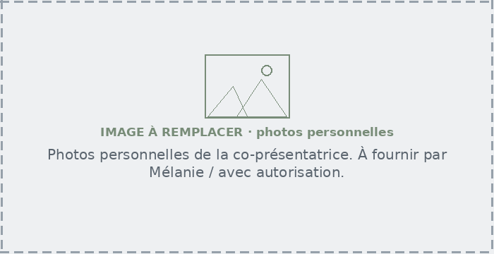

## Avant de commencer {#sec-avant}

### ESRI ArcGIS Online — avez-vous votre accès ?

Rendez-vous sur [https://www.arcgis.com/index.html](https://www.arcgis.com/index.html) et
assurez-vous d'avoir un accès à votre organisation ArcGIS Online avant l'atelier.

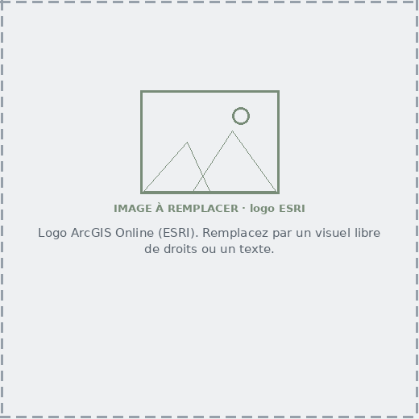{width=45%}

### Installer les applications mobiles

Trois applications terrain de la suite ESRI sont utilisées dans l'atelier :
**QuickCapture**, **Survey123** et **FieldMaps**. Installez-les au préalable.

::: {layout-ncol=2}
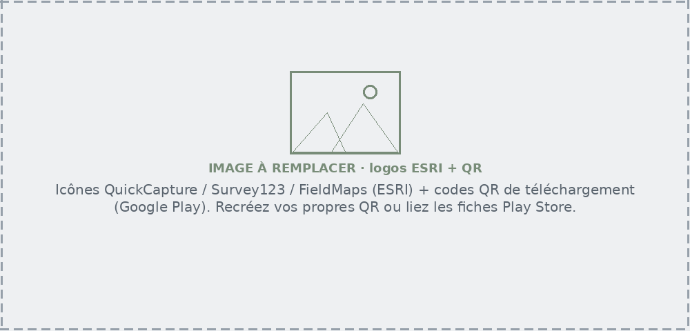

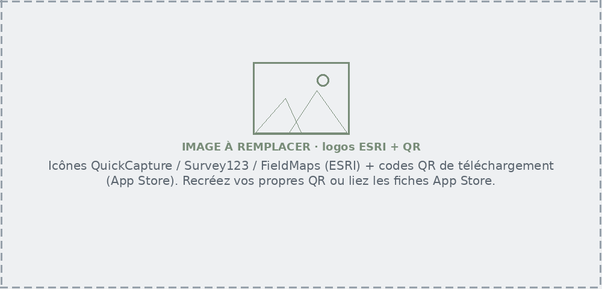
:::

### ArcGIS Survey123 Connect (poste de travail)

Module d'édition du formulaire, normalement exécuté **avant** le terrain sur un ordinateur.
Il sert essentiellement à éditer la table Excel `form.xlsx` sous-jacente au formulaire.

Lien vers le Microsoft Store : [apps.microsoft.com/detail/9pmst5c0dlst](https://apps.microsoft.com/detail/9pmst5c0dlst?hl=en-US&gl=US)

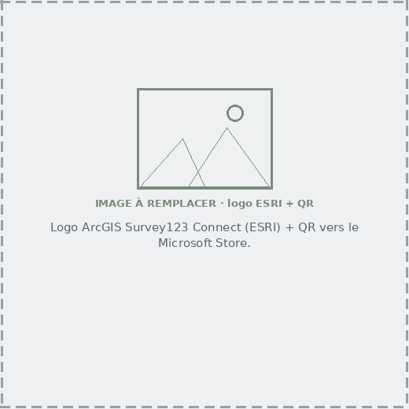{width=45%}

## Plan de l'atelier {#sec-plan}

1. **Introduction** — ArcGIS Online et les applications terrain de la suite ESRI.
2. **Exercices**
   - **Ex. 1** — ArcGIS Online : création de « feature layers ».
   - **Ex. 2** — Projet de recherche « Phénologie du sapin baumier ».
   - **Ex. 3** — Projet de recherche « Inventaire forestier ».
3. **Temps libre** — Tester les applications et/ou construire votre propre application.

## Introduction — applications terrain {#sec-intro-apps}

On distingue les applications selon qu'elles produisent des **données spatiales** ou
**non-spatiales** — certaines font les deux.

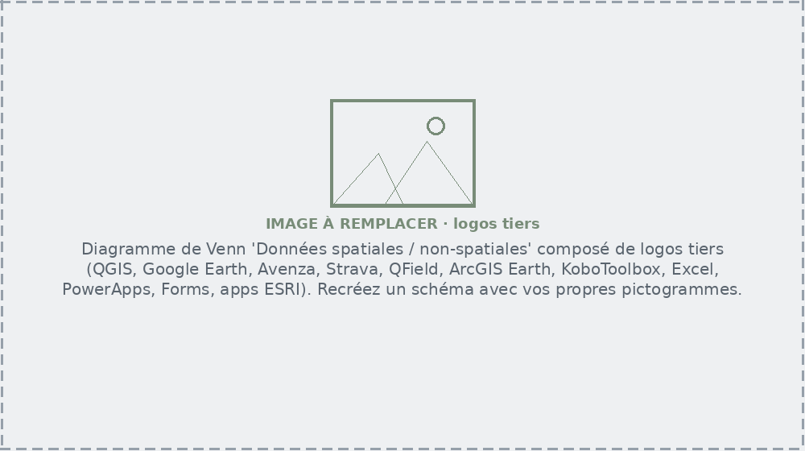

### ArcGIS Online et ses applications

ArcGIS Online est la plateforme centrale : les trois applications terrain (QuickCapture,
Survey123, FieldMaps) s'y connectent pour lire et écrire les données.

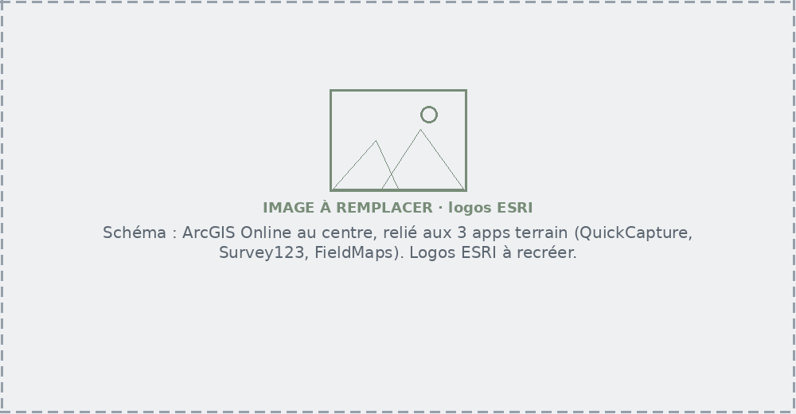

### Comparaison des trois applications

|  | **Survey123** | **QuickCapture** | **FieldMaps** |
|---|---|---|---|
| **Spatiale ou non-spatiale ?** | Les deux | Spatiale (implicitement) | Spatiale (explicitement) |
| **À quoi ça ressemble ?** | Remplir des formulaires qui peuvent être complexes | Saisie rapide, souvent à l'aide de « gros boutons » | Saisie directement sur une carte, avec les fonctionnalités d'un SIG |
| **Édition de données existantes** | Oui | Non | Oui |
| **Édition simultanée de plusieurs couches d'entités** | Non | Oui | Non |
| **Numérisation d'entités linéaires et surfaciques** (ex. enregistrer un chemin) | Non (mais oui aussi) | Oui | Oui |

: Comparaison des fondamentaux — Survey123 / QuickCapture / FieldMaps {.striped .hover}

## L'univers d'ArcGIS Online {#sec-univers}

Tour d'horizon de l'interface d'ArcGIS Online et de ses onglets principaux.

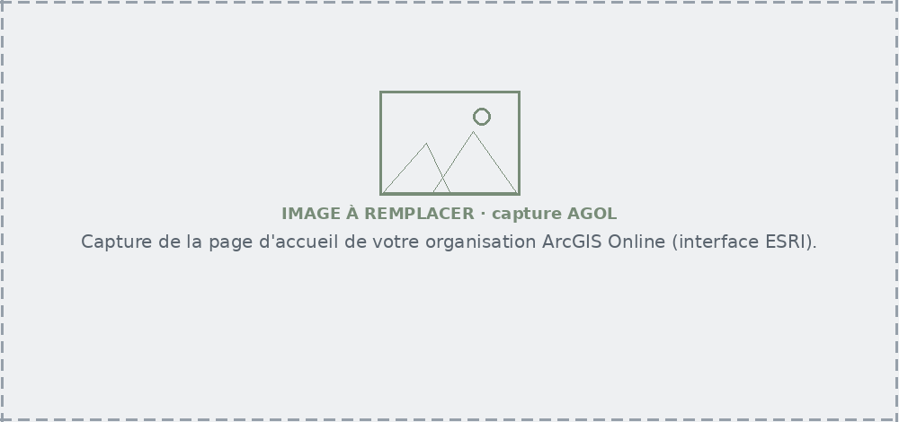

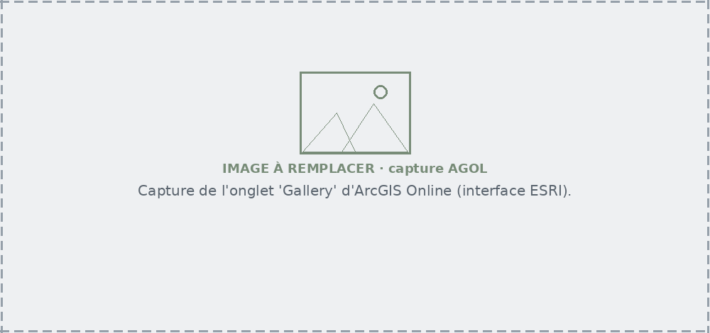

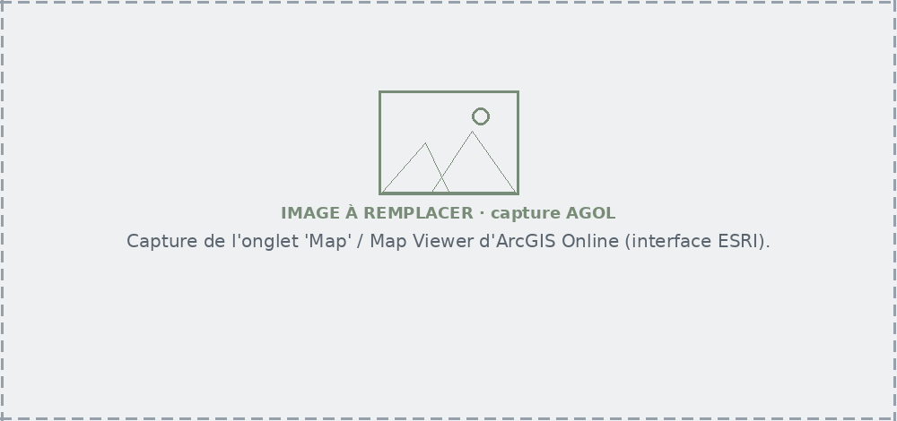

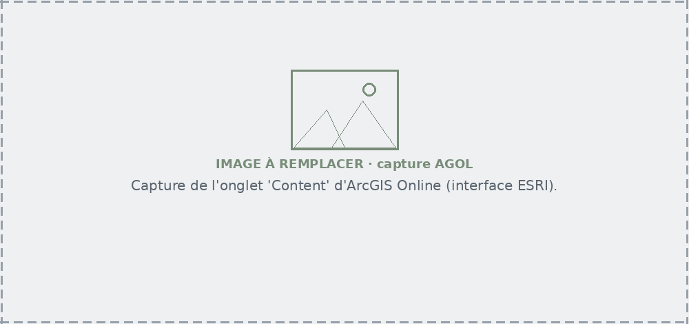

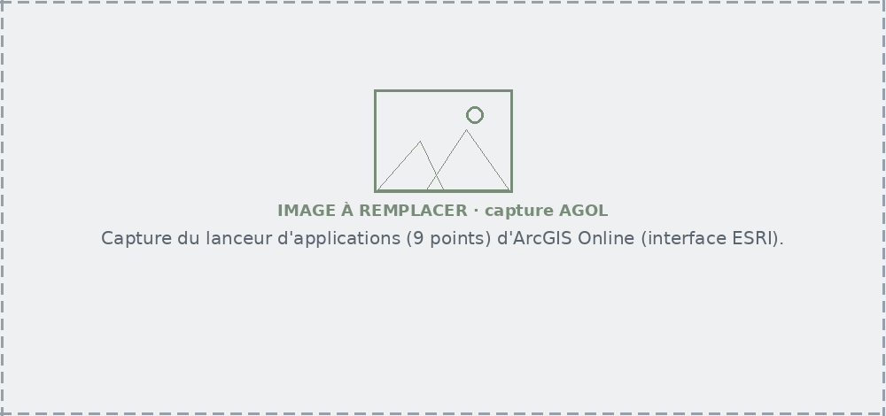

::: {.callout-tip appearance="simple"}
**Questions ?** — C'est le bon moment pour clarifier l'organisation d'ArcGIS Online avant de passer aux exercices.
:::

---

# Exercice 1 — Création de « feature layers » {#sec-ex1}

## Concept : Feature Class vs Feature Layer

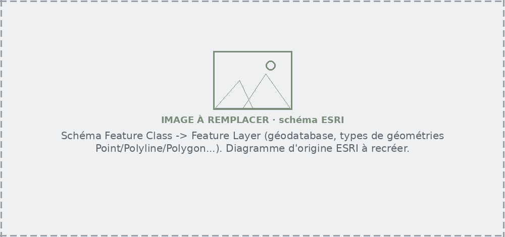

- La donnée est stockée sous forme de **Feature Class**.
- Lorsqu'elle est affichée dans une *Map*, en ligne, etc., elle devient un **Feature Layer**, avec une symbologie, un zoom, etc.
- Un même *Feature Class* peut donc être lié à plusieurs *Feature Layers*, et chacun peut être sauvegardé séparément (*Save as Layer file*).

::: {.callout-note}
**Ouvrir le fichier** `Ex1_CreationFeatureLayer` — l'exercice ci-dessous en reprend l'intégralité du contenu.
:::

## Énoncé de l'exercice

L'objectif de cet exercice est de vous familiariser avec l'univers d'ArcGIS Online et ses
fonctionnalités quant à la création de **couches d'entités** (*feature layers*). L'exercice
couvre la création d'une couche d'entités mais aussi la « bonne conduite » en matière de
gestion de données dans ArcGIS Online. **La couche d'entités créée ici servira à
l'exercice 3.** Pour le reste de l'atelier, nous utiliserons le terme « feature layer ».

**Fichiers nécessaires :** fichier MS Excel `Base_donnee_Ex1_Ex3.xlsx`.

## Étapes

### 1) Créer un « feature layer » dans ArcGIS Online

a. Ouvrir une page web et se connecter à son profil ArcGIS Online : [https://www.arcgis.com/index.html](https://www.arcgis.com/index.html).
b. Cliquer sur l'onglet **Content** et créer un dossier dans lequel le feature layer sera enregistré. L'appeler **`Exercice_1`**.

c. Une fois le dossier `Exercice_1` créé, y entrer (il est vide) et cliquer sur **New Item**.

d. Choisir l'option **Feature layer**.

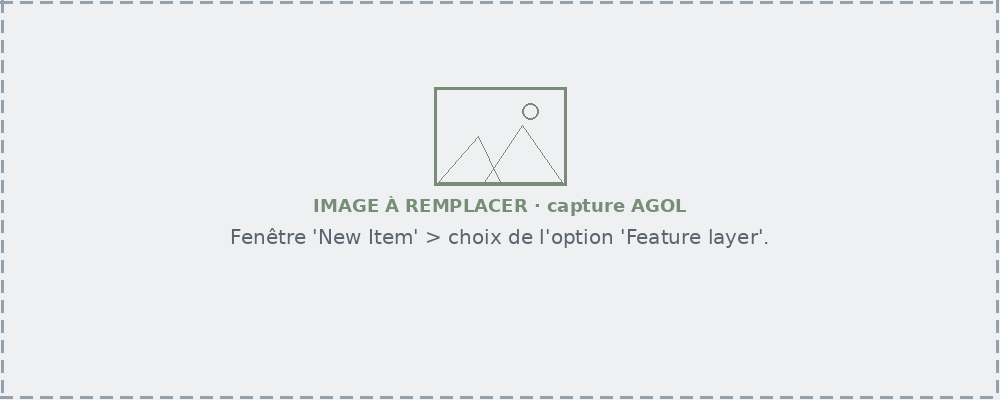

e. Cliquer sur **Define your own layer**, puis sur **Next**.

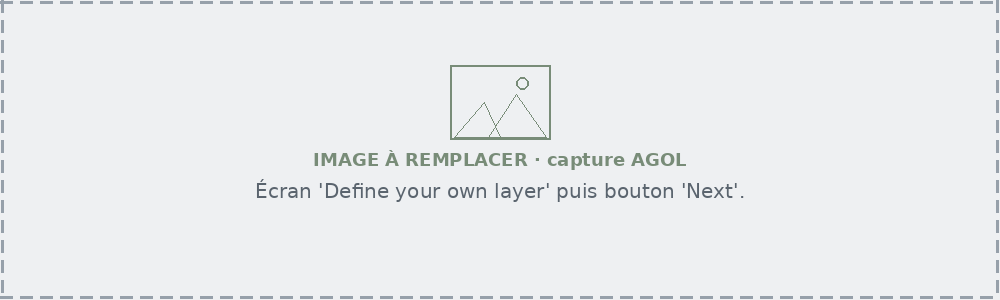

f. Le menu **Create a feature layer** s'ouvre et permet de créer l'ensemble des *feature class* nécessaires au projet. Pour cet exercice, créer **4 couches supplémentaires** avec les noms et topologies suivants :

   - `Donnee_generale` (point)
   - `Inv_forestier` (point)
   - `Chemin_acces` (ligne)
   - `Contour_placette` (polygone)

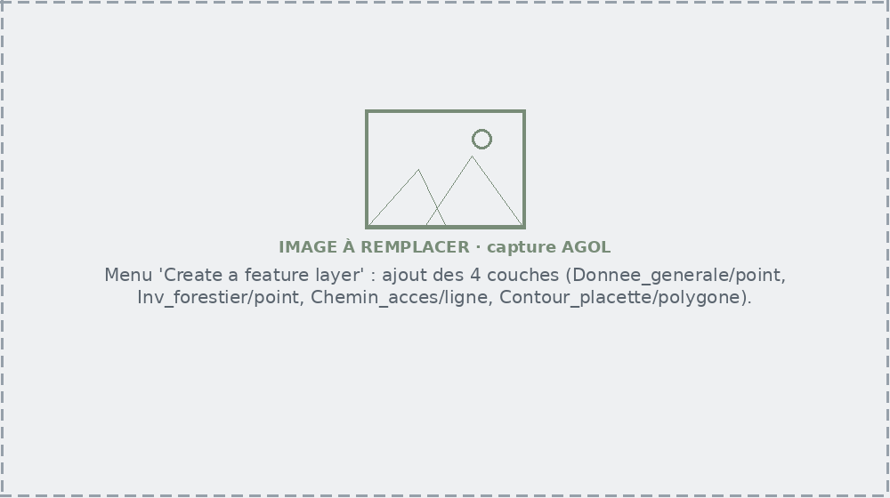

g. Une fois la saisie des couches complétée, cliquer sur **Next**. Donner le nom **`Placette_inv_CN2025`** au feature layer et l'enregistrer dans le dossier `Exercice_1`.

h. Le nouveau feature layer est créé : c'est dans cette fenêtre contextuelle que vous complétez la **description** du fichier. Si le fichier doit être partagé, ajoutez un maximum d'informations afin que les autres utilisateurs comprennent bien les tenants et aboutissants du feature layer.

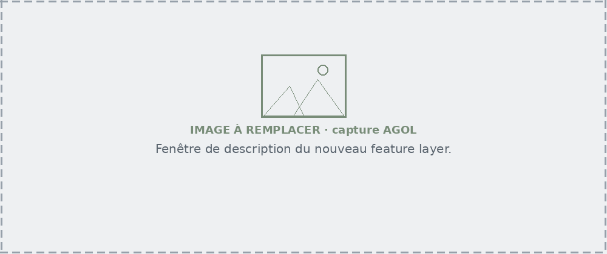

### 2) Configuration d'un « feature layer »

Un fichier MS Excel vous a été fourni : consultez-le pour connaître les champs à créer dans
chaque classe d'entités. **Chaque feuille/onglet du fichier Excel correspond à une couche du
feature layer** (voir `Base_donnee_Ex1_Ex3.xlsx`).

a. Dans l'onglet **Data**, cliquer sur **Fields**.

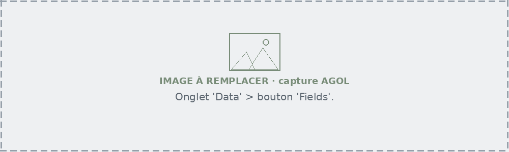

b. Pour ajouter de nouveaux champs, cliquer sur **+ Add**.

{width=55%}

c. Ajouter l'ensemble des champs inclus dans la base de données fournie. Pour chaque nouveau champ, cliquer sur **+ Add** jusqu'à obtenir la liste complète.

::: {.callout-tip appearance="simple"}
**Référence des champs** (feuille `Metadonnee` du fichier Excel) :

| Couche | Champ | Nom | Type | Longueur | Description |
|---|---|---|---|---|---|
| Donnee_generale | `ID_placette` | Identifiant placette | Texte | 25 | Identifiant unique de chaque placette |
| Donnee_generale | `Date_inv` | Date de l'inventaire | Date | — | Date de l'inventaire (sans les heures) |
| Donnee_generale | `X_p` | Longitude | Double | — | Coordonnée géographique |
| Donnee_generale | `Y_p` | Latitude | Double | — | Coordonnée géographique |
| Donnee_generale | `Altitude` | Altitude | Double | — | Altitude GPS |
| Donnee_generale | `Aspect` | Aspect (exposition) | Double | 25 | Exposition de la pente |
| Inv_forestier | `ID_placette` | Identifiant placette | Texte | 25 | Identifiant unique de chaque placette |
| Inv_forestier | `Ess_arbre` | Essence d'arbre | Texte | 50 | Nom de l'espèce d'arbre |
| Inv_forestier | `DHP` | DHP | Double | — | Diamètre à hauteur de poitrine |
| Inv_forestier | `Nv_defo` | Niveau de défoliation | Entier | — | Défoliation par la TBE (0 = 0 % ; 1 = <25 % ; 2 = 25–50 % ; 3 = >50 %) |
| Chemin_acces | `ID_placette` | Identifiant placette | Texte | 25 | Identifiant unique de chaque placette |
| Contour_placette | `ID_placette` | Identifiant placette | Texte | 25 | Identifiant unique de chaque placette |
:::

### 3) Créer une liste dans un champ

a. Cliquer sur le champ **`Ess_arbre`** créé à l'étape précédente.

b. Cliquer sur **Create list**.

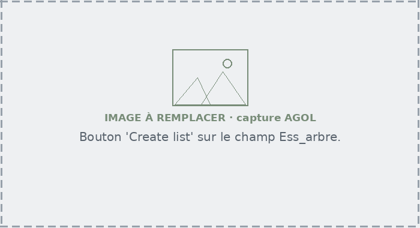{width=55%}

c. Saisir l'ensemble des espèces ligneuses à inventorier. Une fois la liste complète, **sauvegarder** la liste.

### Étapes facultatives — mise en style cartographique

d. Cliquer sur l'onglet **Visualization** afin de passer en mode d'affichage cartographique du feature layer `Inv_forestier`.

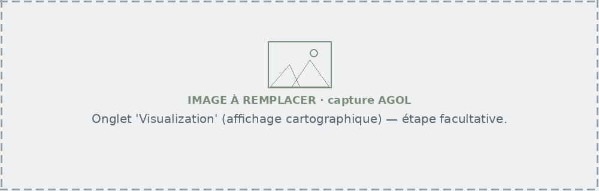

e. Pour afficher les options de la couche `Inv_forestier`, cliquer sur **Layers** dans le menu de gauche, puis sur la couche `Inv_forestier` (les options apparaissent dans le menu de droite).

f. Dans l'onglet **Styles**, choisir **+ Field** et sélectionner le champ `Ess_arbre` (qui contient la liste d'espèces ligneuses).

g. Dans la section **2 - Pick a style**, cliquer sur **Style options** et modifier la couleur des 3 symboles. Cliquer sur **Done**, puis **Save** pour conserver les modifications.

h. Retourner dans votre contenu ArcGIS Online : le feature layer doit se trouver dans le dossier `Exercice_1`.

::: {.callout-tip appearance="simple"}
**Questions ?**
:::

---

# Exercice 2 — Phénologie du sapin baumier {#sec-ex2}

::: {.callout-note appearance="simple"}
**ESRI FieldMaps & Survey123** — Parc national du Bic.
:::

## Contexte et objectifs

| Objectif | Étapes préliminaires | Méthode |
|---|---|---|
| Dans le Parc national du Bic, étudier la **phénologie du sapin baumier** dans des peuplements résineux à dominance de sapin baumier. | 1. À partir du plan de sondage, 7 sapinières ont été identifiées à échantillonner. 2. Dans chaque sapinière, sélectionner 3 individus de sapin baumier sur lesquels une sonde de température et une caméra seront installées ; mesurer le DHP et la hauteur de chaque arbre. 3. Créer un formulaire pour suivre les changements de batteries / cartes SD des caméras et des sondes en cours de saison. | 1. Visualiser le plan de sondage dans ArcGIS Pro et envoyer les données vers ArcGIS Online. 2. Intégrer le plan de sondage et créer un formulaire (feature class) dans FieldMaps Designer. 3. Dans Survey123, créer un formulaire simple de suivi (batteries, cartes SD, sondes). |

: Exercice 2 — objectif, étapes préliminaires et méthode

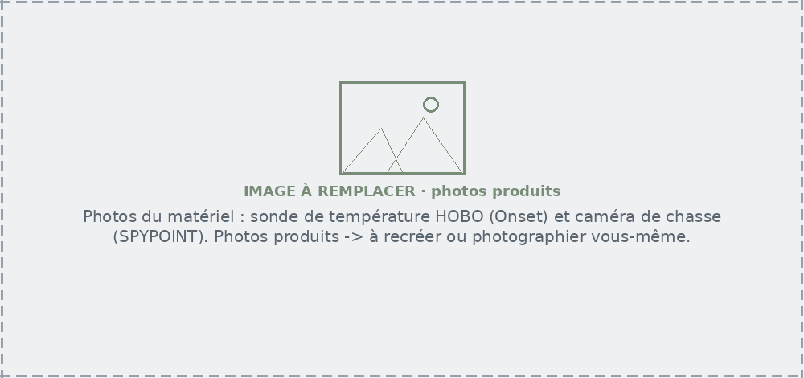

## Énoncé de l'exercice

Dans ce deuxième exercice, on vous demande d'abord d'**intégrer dans un projet ArcGIS
FieldMaps** votre plan de sondage créé dans ArcGIS Pro (une géodatabase vous est fournie),
puis de créer un nouveau formulaire d'acquisition de données géospatiales dans **FieldMaps
Designer** pour la saisie de données explicitement géospatiales sur le terrain.

Le plan de sondage nous guide vers les sites sélectionnés en laboratoire, où l'on collecte
ensuite des données ponctuelles et linéaires. Enfin, **Survey123** sert à créer un formulaire
simple pour le suivi des échantillonnages en cours de saison.

**Mise en contexte.** Dans le cadre de votre projet de recherche, vous suivez le débourrement
du sapin baumier dans le Parc national du Bic. Un plan de sondage de 7 sites potentiels
(peuplements à dominance de sapin baumier) est déjà préparé.

Lors de la première séquence de travail terrain, vous devez, dans chacun des 7 sites, trouver
**3 individus** de sapin baumier sur lesquels vous installez une sonde de température « HOBO »
(identifiant unique) et une caméra de chasse permettant de voir les bourgeons. La carte SD de
chaque caméra possède aussi un identifiant unique. Chaque arbre sélectionné doit être mesuré
(DHP et hauteur), géolocalisé, et ces données compilées dans un formulaire.

Ensuite, le **chemin d'accès** au site doit être cartographié de la route jusqu'à chacun des
3 arbres, afin de spatialiser votre circuit pour les visites de suivi. Le formulaire de suivi
(changements de cartes SD et de sondes « HOBO ») doit inclure l'identifiant unique de chaque
sonde et de chaque carte SD, ainsi que la date de changement pour les 3 individus.

**Fichiers nécessaires :** point de sondage (`Ex2.gdb`) et polygone écoforestier clip (`Ex2.gdb`).

## Étapes

### 1) Créer un dossier « Exercice_2 » dans ArcGIS Online

a. Se connecter à ArcGIS Online : [https://www.arcgis.com/index.html](https://www.arcgis.com/index.html).
b. Onglet **Content** → créer un dossier **`Exercice_2`**.

### 2) Ouvrir ArcGIS Pro et importer les données de la géodatabase

a. Importer / visualiser les données :

   i. Dans ArcGIS Pro, créer un nouveau projet **`Exercice_2`** dans un répertoire de votre choix sur le `C:/`.
   ii. Dans une nouvelle **Map**, ajouter les deux couches de la géodatabase `Ex2.gdb` (dézippée) via **Add data**, puis visualiser les données.
   iii. Sélectionner les deux couches en maintenant **CTRL** enfoncé — les deux couches doivent être en surbrillance.

   iv. Clic droit sur l'une des couches en surbrillance → **Share as web layer**. Dans le panneau de droite, indiquer **Name** = `Ex2_layers` et, sous **Location**, choisir le dossier `Exercice_2` créé dans ArcGIS Online.

   v. Cliquer sur **Analyze** puis **Publish** pour envoyer les couches vers votre contenu ArcGIS Online.

### 3) Créer une « Web map » avec les données

a. Dans ArcGIS Online / Content, cliquer sur le feature layer `Ex2_layers` et l'ouvrir dans le **Map Viewer**.

b. Une fois le Map Viewer ouvert, enregistrer la carte dans le dossier `Exercice_2` sous le nom **`Saisie_donnee_Bic`**.

c. De retour dans le contenu du dossier `Exercice_2`, cliquer sur la Web Map créée et l'ouvrir dans **Field Maps Designer**.

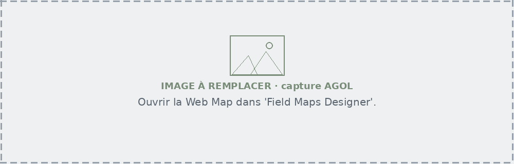

### 4) Créer un nouveau formulaire dans « Field Maps Designer »

a. Dans le bandeau de gauche, sélectionner l'onglet **Forms**, cliquer sur la flèche à droite de **Add Layer**, puis choisir **Create layer**.

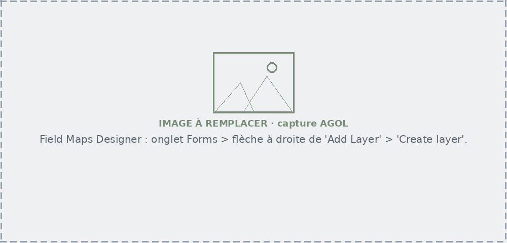

b. Sous **Layer name** :

   i. Inscrire **`Info_arbre_sonde`** en conservant **Layer type** = *Point Layer*.
   ii. Cliquer sur le **+** pour ajouter une seconde couche **`Chemin_acces`** de type *Line layer*.

c. Avant la sauvegarde finale des 2 couches, donner le nom **`Donnee_terrain_Bic_2025`** au feature layer qui contient les 2 couches.

::: {.callout-important}
Sélectionner le **même dossier** `Exercice_2`.
:::

### 5) Création du formulaire pour chacune des deux couches

a. Créer un formulaire pour chaque couche (la structure des données à recueillir sur le terrain). Utiliser les informations du descriptif du projet. Pour cela, sélectionner le type d'élément voulu dans le bandeau de droite et le glisser, dans l'ordre voulu, au centre.

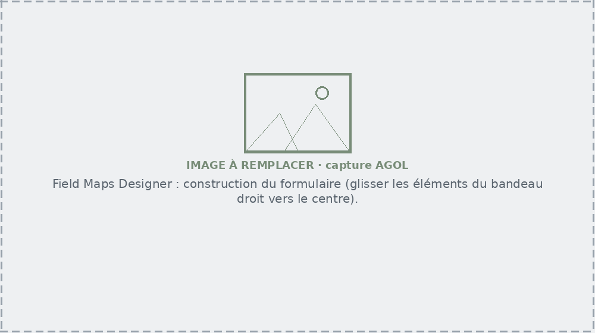

b. Liste des champs voulus pour la couche **`Info_arbre_sonde`** :

   i. Identifiant de la placette
   ii. Date — *le nom du champ doit être différent de « Date » (mot réservé)*
   iii. Identifiant de l'arbre (menu déroulant avec 5 noms prédéfinis)
   iv. Diamètre à hauteur de poitrine (DHP)
   v. Hauteur de l'arbre
   vi. Identifiant de la sonde HOBO
   vii. Identifiant de la carte SD

c. Pour la couche **`Chemin_acces`**, seul un champ qui répète l'identifiant de la placette est nécessaire.

### 6) Ouvrir la carte et saisir des données

Cliquer sur **Sharing** dans le bandeau de gauche, puis utiliser le **code QR** et l'appareil
photo de votre cellulaire pour ouvrir la carte dans FieldMaps.

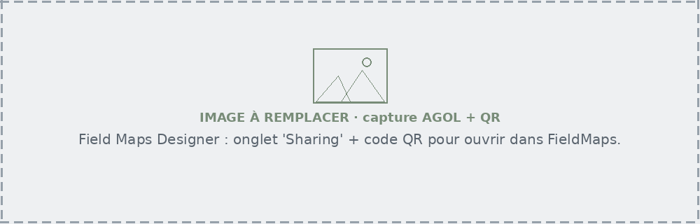

### 7) Acquisition de données dans votre projet FieldMaps !

::: {.callout-important}
Il est important d'**éteindre la fonction GPS** de votre cellulaire pour cet atelier.
:::

### 8) Partie 2 — Formulaire de suivi (sondes « HOBO » et cartes SD)

a. Retourner dans ArcGIS Online et cliquer sur **Survey123** dans le lanceur d'applications (les 9 petits points).

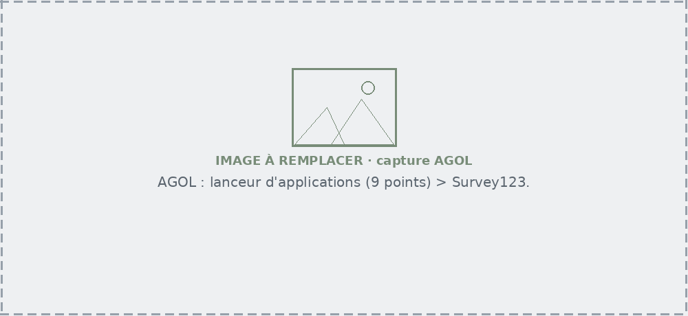

b. Dans ArcGIS Survey123, cliquer sur **+ New survey**…

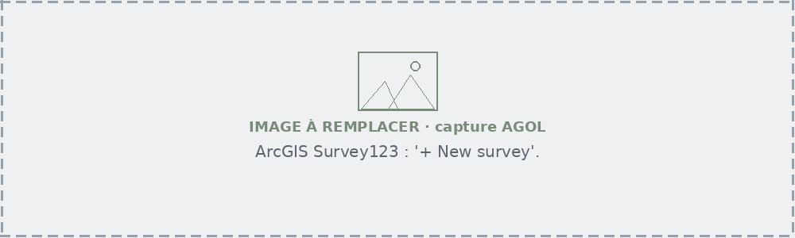

…puis sélectionner **Blank Survey**.

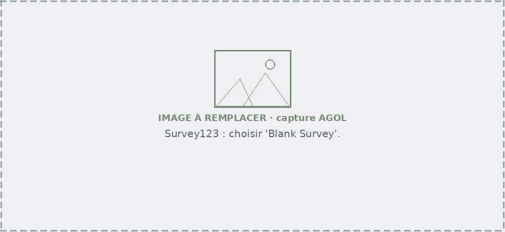

c. Dans Survey123, créer un formulaire **non spatial** qui permettra de suivre les changements de sondes « HOBO » et de cartes SD tout au long de la saison.

d. Avant de commencer l'édition, cliquer dans l'entête pour :

   i. Donner un **nom** à votre formulaire (au fichier).
   ii. Donner un **titre** au formulaire.
   iii. Ajouter une **description** qui facilitera la compréhension du formulaire.

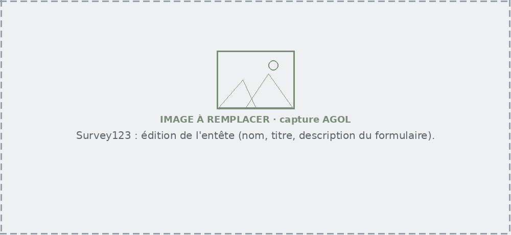

e. Monter le formulaire, puis cliquer sur **Publish**.

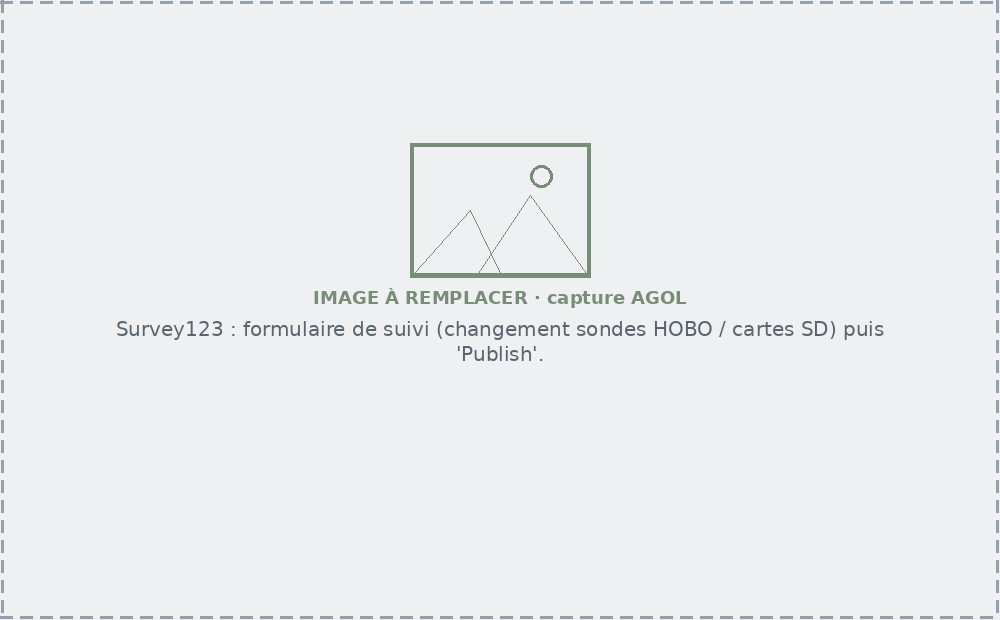

f. Une fois publié, il est accessible via l'application mobile **Survey123**. Il est aussi possible d'enregistrer le **code QR** qui redirige vers l'application.

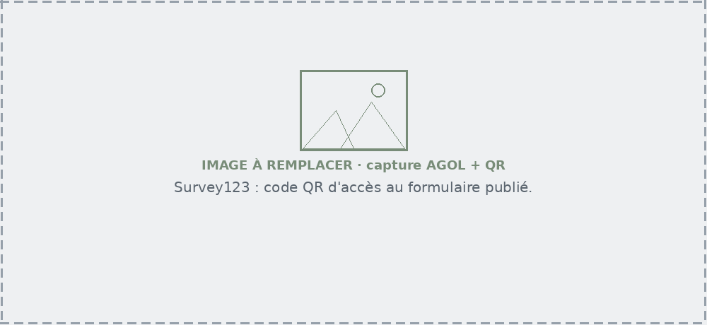

g. Démonstration directement sur l'application !
h. Visualiser / exporter les données dans la table.

::: {.callout-tip appearance="simple"}
**Questions ?**
:::

---

# Exercice 3 — Inventaire forestier {#sec-ex3}

::: {.callout-note appearance="simple"}
**QuickCapture & Survey123** — Côte-Nord, dommages de la TBE (tordeuse des bourgeons de l'épinette).
:::

## Contexte et objectifs

| Objectif | Étapes préliminaires | Méthode |
|---|---|---|
| Sur la Côte-Nord, évaluer les dommages causés par la **TBE** sur ses 3 espèces-hôtes. Dans une placette de 1 ha, inventorier l'ensemble de ces arbres (sapin baumier, épinette noire, épinette blanche) et évaluer leur niveau de défoliation. | 1. Dans une placette de 100 m × 100 m, géolocaliser l'ensemble des hôtes de la TBE et évaluer leur niveau de défoliation. 2. Pour chaque arbre : coordonnée XY, DHP, niveau de défoliation cumulée. 3. Numériser un chemin d'accès vers la placette et tracer son périmètre (empreinte générale de la placette). | 1. Création de feature layers dont les champs serviront à générer un formulaire QuickCapture. 2. **Ex. 3a** : paramétrage du formulaire QuickCapture (règles de validation, types de boutons). 3. **Ex. 3b** : Survey123 & Survey123 Connect — créer un formulaire d'inventaire similaire, où les arbres ne sont **pas** géolocalisés. |

: Exercice 3 — objectif, étapes préliminaires et méthode

::: {.callout-note}
**Ouvrir les fichiers** `Ex3a_Inventaire_forestier` et `Ex3b_Inventaire_forestier` — repris intégralement ci-dessous.
:::

## Énoncé général

On vous demande de créer un formulaire **QuickCapture** qui permet la collecte de données
**ponctuelles, linéaires et surfaciques** dans une même application. Dans ce projet, vous
connaissez la localisation du peuplement à échantillonner, mais pas encore celle des arbres
ni du centre exact de la placette. Vous savez où stationner le long du chemin, mais le chemin
d'accès n'est pas encore tracé.

**Partie 1 — QuickCapture.** Utiliser le *feature class* créé à l'exercice 1 pour générer et
configurer une application ArcGIS QuickCapture dans laquelle :

- la **1re section** compile les données générales de la placette : identifiant, coordonnées XY, date, altitude, orientation de la pente (aspect) ;
- la **2e section** géolocalise les arbres et compile les données d'inventaire des espèces susceptibles à la TBE (dont DHP et niveau de défoliation) ;
- la **3e section** numérise le chemin d'accès (ligne) et le contour de la placette (polygone).

**Partie 2 — Survey123.** En inventaire forestier, il n'est pas toujours nécessaire de
géolocaliser individuellement les arbres si l'on s'intéresse plutôt au volume de bois ou à la
surface terrière par espèce à l'échelle du peuplement (comme dans la carte écoforestière).
Nous verrons comment remplacer les sections « données générales » et « inventaire des arbres »
de QuickCapture par un formulaire créé dans Survey123. Au terme de l'exercice, il sera
possible de comparer les avantages de chaque application pour un inventaire forestier.

## Partie 1 — QuickCapture (Ex. 3a) {#sec-ex3a}

**Fichiers nécessaires :** `Placette_inv_CN2025` (feature layer de l'exercice 1) —
couches `Donnee_generale`, `Inv_forestier`, `Chemin_acces`, `Contour_p`.

### 1) À partir de votre compte ArcGIS Online

A. Créer un nouveau dossier **`Exercice_3`**. Aller dans le dossier `Exercice_1` et **copier son contenu** dans `Exercice_3`.
B. Ouvrir le lanceur d'applications (9 petits points) et lancer **QuickCapture**.

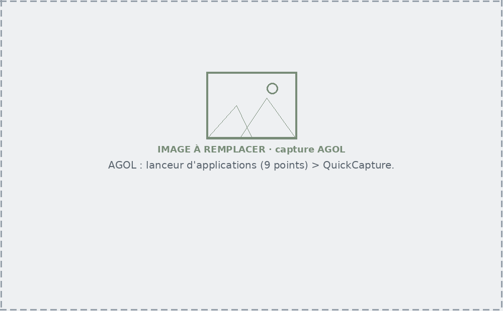

C. Dans **ArcGIS QuickCapture app Designer**, cliquer sur **+ New Project** puis **Start from existing layers**.

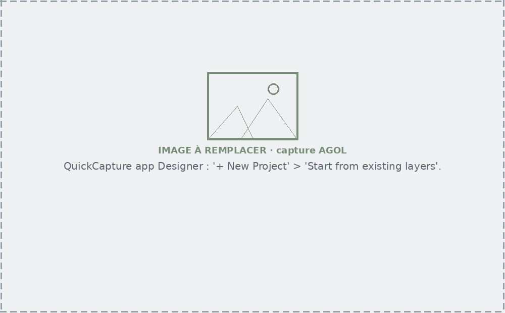

D. Sous **My layers**, sélectionner le feature layer créé à l'exercice 1 : **`Placette_inv_CN2025`**. Dans la fenêtre contextuelle en bas de page, s'assurer que **Create buttons from layer symbology** est sélectionné, puis cliquer sur **Next**.

E. Dans la fenêtre **Create Project**, donner le titre **`Inventaire_TBE_2025`** et enregistrer le projet dans le dossier `Exercice_3` (plutôt que `Root`).

### 2) Éléments du ArcGIS QuickCapture Designer

L'énumération suivante fait référence à l'image ci-dessous.

A. **Messages** — messages d'erreur et avertissements. *Prenez le temps de les lire et de les comprendre !* Il est impossible de sauvegarder l'application tant que des messages d'erreur sont actifs.
B. **Paramètres de l'application**

   i. Type d'appareil sur lequel l'application sera utilisée (meilleure disposition des boutons).
   ii. Paramètres généraux : couleur d'arrière-plan, tolérance GPS, taille des photos.
   iii. **Manage project layer** — modifier le(s) feature layer(s) utilisé(s).
   iv. **Configure map project**.
   v. **Additional settings** : *Project details, Project user inputs, Button user inputs*, etc.

C. Section pour **paramétrer chacun des boutons** de saisie.
D. **Aperçu** de l'application finale.

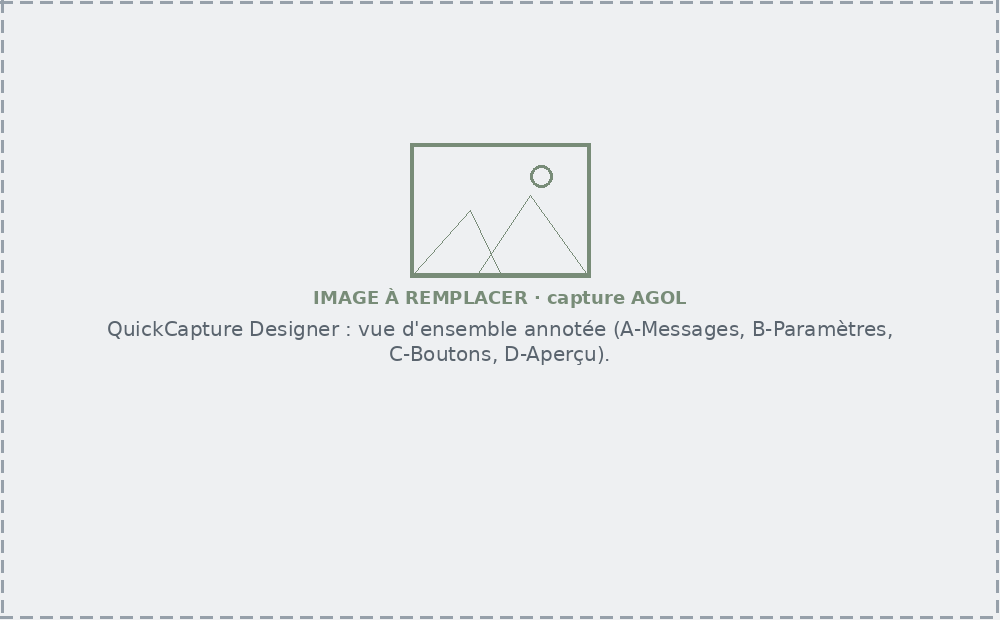

### 3) Configurer l'application — paramètres généraux et additionnels

A. Régler l'affichage selon l'appareil utilisé lors de la campagne d'échantillonnage.
B. Dans les paramètres généraux, choisir une couleur de fond.
C. Dans l'onglet **Map**, conserver le fond de carte par défaut (*Topographic*).
D. Dans **Additional settings → Project details** :

   i. Modifier le titre (enlever les *underscores*) ;
   ii. Valider l'adresse courriel de référence ;
   iii. Ajouter une description (surtout si d'autres personnes utiliseront l'application).

### 4) Configurer les sections de l'application

A. Cliquer directement sur le nom de chaque section pour configurer son apparence :

   i. Sous **Label**, renommer en **« Données générales »** ;
   ii. Conserver **une seule colonne** ;
   iii. Enlever l'option **Make group collapsible** ;
   iv. Mettre une couleur de bordure apparente par rapport au fond choisi ;
   v. Répéter pour les **4 sections**. *Pour le groupe « Inventaire forestier », mettre 3 colonnes.*

### 5) Configurer les boutons et la saisie de données

**A. Groupe « Données générales » — section *Appearance***

   i. Cliquer sur le bouton **New Feature** pour ouvrir le menu de droite.
   ii. Sous **Label**, définir le texte affiché sous le bouton : **« Coordonnées au centre de la placette »**.
   iii. Régler taille, forme, couleur, bordure et **icône** du bouton.

**B. Groupe « Données générales » — section *Data***

   i. Cette section configure les actions du bouton.
   ii. Valider le **Target feature layer** (devrait être `Donnee_generale`).
   iii. **Capture mode** : *Single point*. Ne pas activer *Show map after capture* ni *Show camera*.
   iv. **Capture fields** :
      1. `ID_placette` : dans le menu déroulant **Project user inputs**, créer un nouveau *Project user input* nommé **« Identifiant unique de la placette »**, de type *Single line text*, avec **This is a required user input** activé. Activer aussi **Apply hint** et inscrire **« Format requis : P001 »**.
      2. Les champs `X_p`, `Y_p`, `Altitude`, `Aspect` et `Date_inv` doivent tous être des **Device variables**.
      3. Pour chacun, sélectionner le type de donnée correspondant dans le menu déroulant de droite.
      4. *Explication* : à l'ouverture, l'application demande automatiquement l'identifiant unique de la placette (avec exemple de format). Ce champ implémente `ID_placette` dans chacun des feature layers.

**C. Groupe « Inventaire forestier »**

   i. *Appearance* — Label : **« Sapin baumier »** ; Colors : vert foncé ; Image : icône d'arbre.
   ii. *Data* :
      1. Valider le **Target feature layer**.
      2. `ID_placette` : **Project user inputs** → *Identifiant unique*.
      3. `Ess_arbre` : sélectionner **« Sapin baumier »** dans le menu déroulant.
      4. `DHP` : **Button user inputs** → « Diamètre à hauteur de poitrine », *required user input*, *End of capture* → **Create**.
      5. `Nv_defo` : **Button user inputs** → « Niveau de défoliation », *required user input*, *End of capture* → **Create**.
      6. *Explication* : `ID_placette` est rempli automatiquement par le *Project user input* ; « Sapin baumier » est inscrit automatiquement dans `Ess_arbre` ; `DHP` et `Nv_defo` sont ensuite remplis par des fenêtres contextuelles successives.
   iii. Pour créer le prochain bouton, utiliser la fonction **Duplicate**.

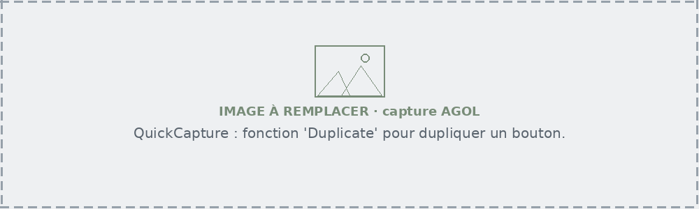

   iv. Répéter pour créer un bouton **« Épinette noire »** et un bouton **« Épinette blanche »**.

**D. Groupe « Chemin d'accès »**

   i. *Appearance* — Label : « Appuyer pour commencer et arrêter la saisie du chemin » ; Colors : au choix ; Image : icône de sentier / tracé.
   ii. *Data* — valider le **Target feature layer** ; `ID_placette` : **Project user inputs**.

**E. Groupe « Contour de la placette »**

   i. *Appearance* — Label : « Appuyer pour commencer et arrêter la saisie du contour » ; Colors : au choix ; Image : icône de polygone / surface.
   ii. *Data* — valider le **Target feature layer** ; `ID_placette` : **Project user inputs**.

### 6) Sauvegarder et utiliser l'application

A. Sauvegarder le projet et définir les options de partage.
B. Enregistrer le **code QR** si nécessaire.
C. Ouvrir l'application QuickCapture sur votre appareil mobile, appuyer sur le **+** en bas de l'écran pour scanner le QR (ou sélectionner parmi vos applications QuickCapture associées à votre compte).

## Partie 2 — Survey123 (Ex. 3b) {#sec-ex3b}

**Fichiers nécessaires :** `Donnee_generale`, `Inv_forestier`, et `Base_donnee_EX1_EX3.xlsx`.

### 1) À partir de votre compte ArcGIS Online

A. Ouvrir le lanceur d'applications (9 petits points) et lancer **Survey123**.

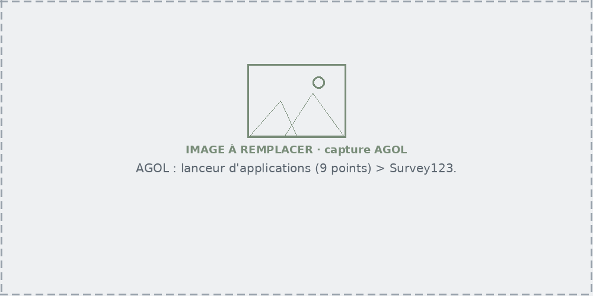

B. Dans ArcGIS Survey123, cliquer sur **+ New survey** puis **Blank survey**.

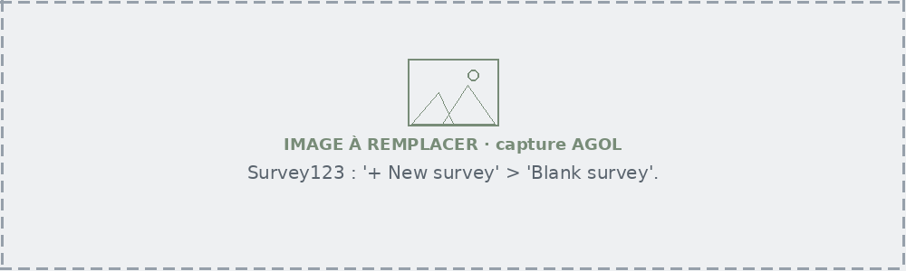

C. **Création du formulaire de base**

   i. À l'ouverture de l'éditeur, remplir la section **Survey info** puis le **header** du formulaire.
      *Choisir un **nom** pour le formulaire (Survey info = information affichée dans l'application mobile), puis un **titre** (affiché à l'ouverture de l'application).*

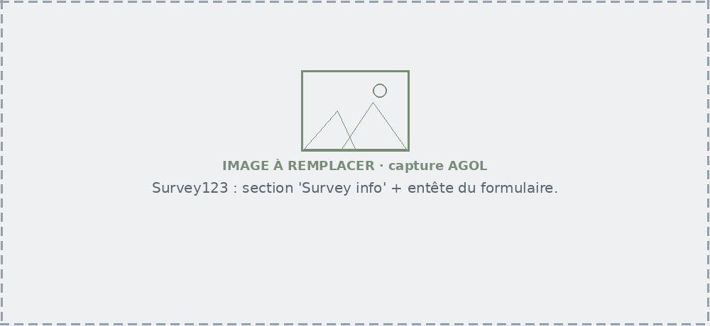

   ii. À l'aide du fichier `Base_donnee_EX1_EX3.xlsx` (onglets `Donnee_generale` et `Inv_forestier`), construire un formulaire à **2 groupes** :
      1. Le **1er groupe** compile les données générales de la placette, incluant la coordonnée centrale. **⚠️ Important :** portez une attention particulière aux champs demandés — Survey123 ne permet pas nécessairement de collecter exactement les mêmes données que QuickCapture.
      2. Le **2e groupe** compile les données d'inventaire des arbres hôtes de la TBE et doit comporter un **menu déroulant / liste de choix** pour les 3 espèces hôtes.
      3. Types d'éléments impliqués : *Date, Slider, Single line text, Single select / Dropdown, Map* (usage non obligatoire).
      4. Une fois complété, **enregistrer** puis **publier** le formulaire.

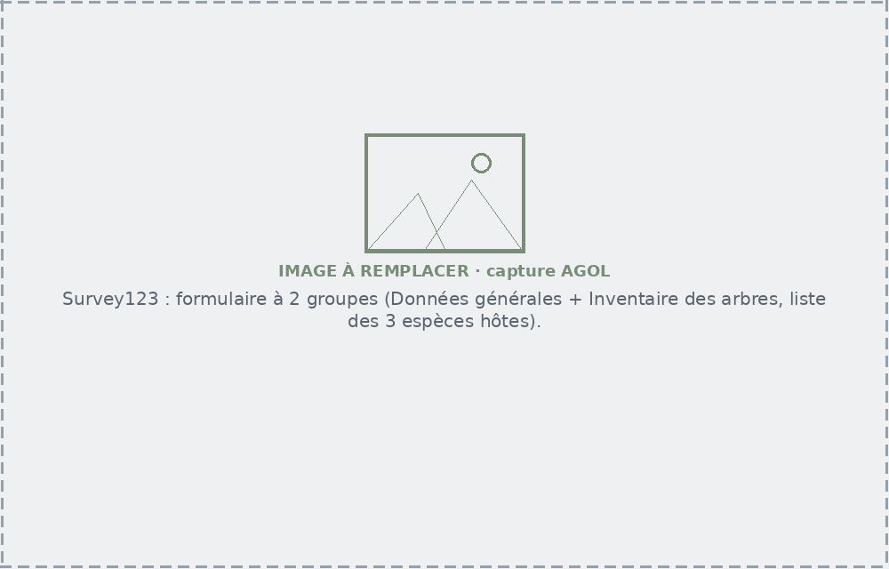

D. Tester le formulaire dans l'application.

::: {.callout-tip}
**Question 1** — Est-il possible de faire la collecte de plus d'un type de géométrie dans l'application ?
:::

::: {.callout-tip}
**Question 2** — Qu'est-ce qui manque à notre formulaire pour réaliser un inventaire forestier complet ? Votre formulaire permet-il de compiler plusieurs données d'inventaire d'arbres, ou la saisie est-elle limitée à 1 arbre à la fois ?
:::

E. **Édition avancée du formulaire**

   i. Sur votre ordinateur, ouvrir **ArcGIS Survey123 Connect** et y connecter votre compte.
   ii. Télécharger le formulaire que vous venez de créer dans le Survey123 designer en ligne.

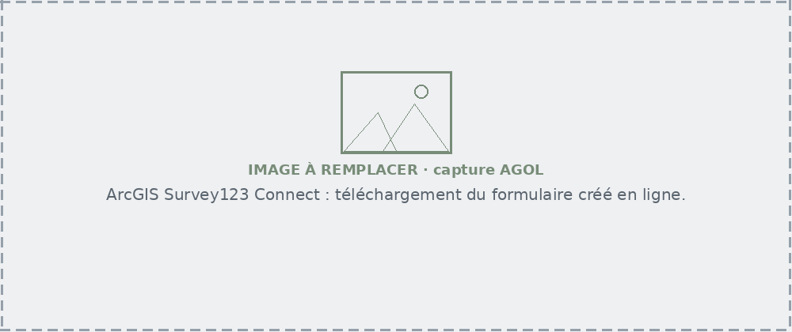

   iii. Cliquer sur l'icône du formulaire pour en faire l'édition.

F. **Fonctionnalités de ArcGIS Survey123 Connect**

   i. Passer en revue les options du **ruban inférieur** (options du formulaire).
   ii. Passer en revue les options du **ruban gauche**.

G. **« One to many »**

   i. Ajouter la fonction **repeat** dans le formulaire.
   ii. Cliquer sur **XLSForm**.

   iii. À l'ouverture du fichier `.xlsx`, visualiser la structure sous-jacente du formulaire (notamment l'onglet **choices** pour construire une liste — ajoutez une espèce de plus à la liste).
   iv. Dans l'onglet **survey**, insérer une nouvelle rangée sous la rangée `begin group` reliée au groupe *Inventaire forestier*.
   v. Sous le champ **type**, choisir **begin repeat** (rangée 12 dans l'exemple) :
      1. **name** : `Repetition`
      2. **label** : « Saisir un arbre »
   vi. Sous **type**, choisir **end repeat** (rangée 17 dans l'exemple).
   vii. Sauvegarder et fermer le fichier `.xlsx`.
   viii. Dans Survey123 Connect, appuyer sur **Mettre à jour** (*Update*).
   ix. Retourner dans l'application mobile et mettre à jour l'application.

::: {.callout-tip}
**Question 3** — Expliquez ce qui a changé dans l'application.
:::

**FIN !**

::: {.callout-tip appearance="simple"}
**Questions ?**
:::

---

# Fin de l'atelier {#sec-fin}

Pour toutes questions sur vos projets de recherche, les professionnels de recherche du CEF
sont là ! Voici le lien pour voir « qui fait quoi » :
[cef-cfr.ca — Professionnels de recherche](https://www.cef-cfr.ca/pmwiki.php?n=Membres.Accueil#profrech).

## Temps libre

**Tester les applications et poser des questions !**

## Votre prochain défi

**Intégrer vos données dans un ArcGIS Dashboard.**

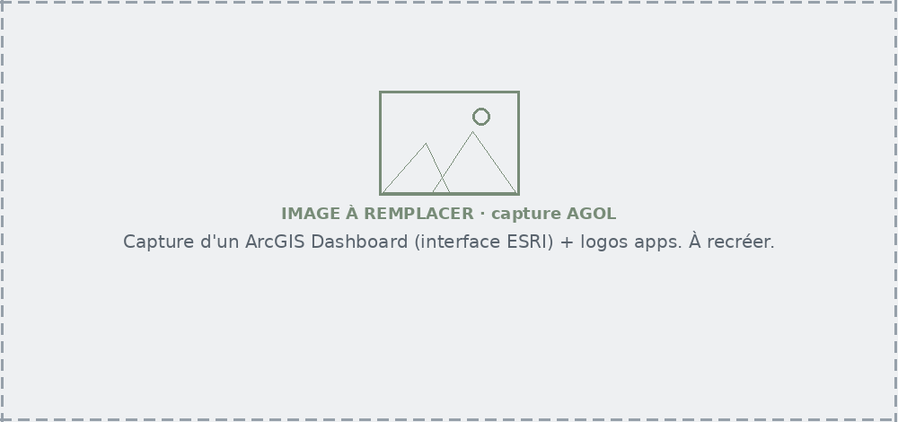

## Synthèse

Séance d'information des outils ESRI — comparaison des fondamentaux
(*Survey123 / FieldMaps / QuickCapture*).

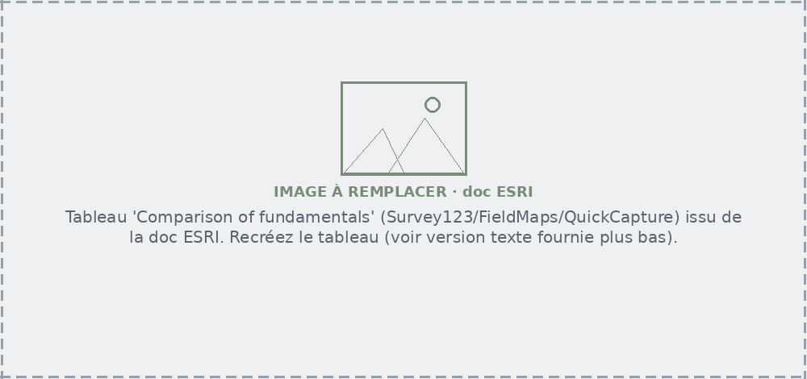
