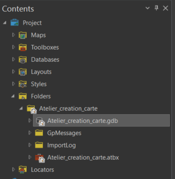

{width="120px" fig-alt="Logo du Centre d'étude de la forêt"}

## Contexte de l'atelier {.unnumbered}

Vous venez de finir l'écriture d'un article scientifique ou de votre
mémoire / thèse de fin d'études et vous désirez créer une carte de
localisation de tous les points d'inventaire réalisés lors de votre
collecte de données terrain. L'objectif est de publier une carte de
qualité qui montre la répartition spatiale de vos points
d'échantillonnage, ainsi que le contexte plus général dans lequel se
trouve votre aire d'étude.

Dans cet atelier, nous allons mettre en pratique plusieurs des éléments
couverts par la formation « ArcGIS Pro pour les nuls » tout en mettant
de l'avant certaines spécificités liées à la production de ce type de
carte.

::: {.callout-note}
## Données requises
Les données nécessaires à la réalisation de cet atelier vous sont
fournies dans une géodatabase (`.gdb`) transmise par courriel.
:::

### Fichiers nécessaires {.unnumbered}

| Source | Classe d'entité / Table |
|---|---|
| `Atelier_creation_carte.gdb\Donnee_EX01` | `Feux_s` (contour du feu à l'étude) |
| | `Lieu_habite_s` (villes du Québec) |
| | `N3_DOM_BIO_s` (domaines bioclimatiques) |
| | `Prov_qclcc_s` (province du Québec) |
| Table (hors `.gdb`) | `Site_etude_p.csv` |
| `Atelier_creation_carte.gdb\Donnee_supp` | `AOI` (*Area of interest*) |
| | `FEUX_PT_ORI_clipAOI` |
| | `META_FEUX_clipAOI` |
| \* Classification écologique | `N1_[...]`, `N2_[...]`, `N4_[...]`, `N5_[...]` |
| \*\* Carte écoforestière | `PEE_DS`, `PEE_EN_PG`, `PEE_ORI_CLIP_FEU` |

## Créer un projet dans ArcGIS Pro

a. Ouvrir ArcGIS Pro et créer un nouveau projet « Map ».
b. Nommer le projet **« Carte_localisation »** et choisir le dossier
   (sur votre clé / disque dur externe) où seront vos données. Garder
   le crochet qui créera un nouveau dossier pour ce projet.
c. Dans l'onglet **View**, cliquer sur **Catalog view**. Sous le dossier
   *Folders*, vous trouverez un dossier « Carte_localisation » avec une
   maison : c'est là que vous enregistrerez les données que vous
   modifierez pour produire votre carte.

   Pour accéder à la géodatabase (`.gdb`) qui contient les données de
   base, cliquez sur *Folders* dans l'arborescence du catalogue, puis
   sur l'onglet **Insert → Add Folder**, et naviguez jusqu'au répertoire
   où vous avez enregistré les données fournies. Cette action fera un
   « pont » entre ArcGIS et le dossier de données.

::: {.callout-tip}
Il existe aussi un **Catalog Pane**, version réduite du catalogue, sur la
droite de l'écran.
:::

{width="320px" fig-alt="Capture d'écran du panneau Catalog affichant l'arborescence du projet"}

d. Clic sur `Atelier_creation_carte.gdb\Donnee_EX01` et prenez
   connaissance de tous les fichiers et des métadonnées associées
   (cliquez sur chaque couche et regardez, à droite : *Metadata*,
   *Geography* et *Table*).
e. Toujours dans le panneau *Catalog*, vérifiez le système de
   coordonnées de chacun des fichiers avec **clic-droit → Properties →
   Spatial Reference**. Si nécessaire, reprojetez les couches qui ne
   sont pas projetées ou qui ne sont pas dans le bon système.
f. Clic sur **Map** : on voit le Québec. Dans l'onglet **Map**,
   choisissez l'icône **Basemap** puis « Light Gray Canvas ».

   ::: {.callout-note}
   Pour confirmer la référence spatiale du projet : **clic-droit sur Map
   → Properties → Coordinate Systems**. Nous allons travailler en
   **NAD 1983 Québec Lambert**.
   :::

g. Ajoutez les couches contenues dans le *Feature Class Dataset*
   `Donnee_EX01` avec l'icône **Add Data → Folders → Donnee_atelier →
   Atelier_creation_carte.gdb**. Vous pouvez ajouter les 4 couches d'un
   seul coup.

::: {.callout-important}
Le projet emprunte toujours la référence spatiale de la **première
couche ajoutée**. Toutes les autres s'afficheront à la volée pour s'y
aligner.
:::

## Importer, afficher et créer un *feature class* à partir d'un fichier Excel ou CSV

*(Peut aussi être en format `.dbf` — « data base file ».)*

a. Dans la géodatabase du projet, vous constaterez qu'aucun fichier de
   points ne s'y trouve : le fichier de points est enregistré au format
   `.csv`. Deux options s'offrent à vous.

   **Option i — via Map :**
   *Add Data*, clic sur le fichier `Site_etude_p.csv`. Dans
   l'arborescence des couches, clic-droit sur la table → **Open** pour
   déterminer quelles colonnes stockent les coordonnées géographiques
   (souvent LAT/LONG, ou XY, POINT_X, POINT_Y, etc.). Fermez la table.
   Clic-droit sur la table `Site_etude$` → **Create points from table →
   XY Table To Point**. Dans l'outil, remplir : *Output* =
   `.gdb\Donnee_EX01\Site_etude`, *X field* = `POINT_X`, *Y field* =
   `POINT_Y`, *Coordinate System* = cliquer sur le petit globe, chercher
   « 1983 » dans *North America / Canada* pour NAD 1983. **OK**.

   **Option ii — via Catalog :**
   Sur la table `.csv`, clic-droit → **Export → Table to Point Feature
   Class**. L'outil *XY Table To Point* s'ouvre à droite dans le panneau
   *Geoprocessing*. Précisez les mêmes paramètres que ci-dessus.

b. Une fois l'étape complétée, retournez dans la `.gdb` maison où vous
   avez enregistré la couche, clic-droit → **Add to map**.

## Créer la carte générale de localisation avec fond « gris neutre »

a. Dans le panneau d'arborescence (*Drawing order*), clic-droit sur
   **Map → Properties**, puis dans *General → Name*, renommez la carte
   **« Carte_site_etude »**.
b. Dans cette carte, ajoutez le fond de carte et les couches suivantes :
   i. Fond de carte : « Light Gray Canvas »
   ii. `Feux_s`
   iii. `Site_etude_p`
   iv. Quelles autres couches (*feature class*) ajouteriez-vous au
       projet ?
   v. En prévision de l'assemblage de la carte, dans quel ordre
      positionneriez-vous les couches dans l'arborescence, et pourquoi ?
c. Modifions maintenant la symbologie des couches en préparation à
   l'assemblage :
   i. **`Feux_s`** : contour rouge, fond rouge + transparence 50 %.
   ii. **`Site_etude`** : passez de *Single symbol* à *Unique values*,
       et dans *Field 1* sélectionnez le champ qui contient la
       classification des sites **par essence d'arbre**. Ajustez les
       symboles de chaque essence (couleur, taille) en vous assurant
       qu'ils sont bien visibles sur le périmètre du feu.
   iii. Les couleurs / transparence du feu ne vous conviennent pas ?
        Faites des tests, tout en gardant l'information claire et
        visible !
   iv. Si vous avez ajouté d'autres couches, attribuez-leur aussi une
       symbologie appropriée.

## Créer une mise en page cartographique (*layout*)

a. Dans l'onglet **Insert → New Layout**, naviguez jusqu'à **Custom page
   size** (tout en bas du menu déroulant).
   i. Dans *Layout properties → Page Setup*, changez les *Page Units*
      pour **Millimeter**, largeur **190 mm**, hauteur **120 mm**. Ceci
      correspond à une demi-page / deux colonnes selon les normes
      Elsevier.

   ::: {.callout-note}
   ## Dimensions maximales des revues
   - **Elsevier** : largeur 190 mm × hauteur 240 mm
   - **Springer** : largeur 174 mm × hauteur 234 mm

   Consultez toujours les normes de la revue visée. Il est plus simple
   de définir les bonnes dimensions dès le départ que de redimensionner
   la figure ensuite.
   :::

b. Une page blanche s'affiche. Renommez « Layout » dans l'arborescence
   pour **« Carte de localisation »**.
c. Ajoutez des **guides** pour conserver une marge : clic-droit sur la
   règle → **Multiple guides** → *Both*, *Offset from edge*, **10 mm**.

   ::: {.callout-tip}
   Il est toujours possible de déplacer les guides manuellement en
   cliquant sur la flèche bleue associée à un guide, directement sur la
   règle.
   :::

d. Cliquez sur **Map Frame** et sélectionnez la carte
   « Carte_site_etude ». Tracez la zone de façon qu'elle « snap » sur les
   guides.

## Ajouter les éléments d'habillage graphique

a. Flèche du nord
b. Grille de coordonnées géographiques
c. Échelle graphique
d. Crédit « Esri, TomTom, Garmin » — que faire avec ça ?
e. Légende, date, auteurs et sources des données

## Ajouter une emprise — contexte géographique global

*(Carte à plus petite échelle.)*

a. Dans l'onglet **Insert**, créez une **New Map**. Renommez-la
   **« Carte_generale »**.
b. Changez le *Base Map* pour **Light Gray Canvas** (identique à
   « Carte_site_etude »).
c. Ajoutez :
   i. le périmètre du feu ;
   ii. le périmètre de la province du Québec ;
   iii. la couche des domaines bioclimatiques ;
   iv. la couche `Lieu_habite`.

   ::: {.callout-warning}
   Validez pour **chaque** couche la projection géographique (ou son
   absence) et, si nécessaire, reprojetez.
   :::

d. Questionnez-vous sur le *drawing order* : quelle couche devrait
   apparaître en premier ? Ordonnez les couches selon ce que vous croyez
   être la meilleure ordination.
e. Apportez plusieurs modifications à ces couches :
   i. **Domaines bioclimatiques** : clic-droit → *Properties → Definition
      Queries*. Nouvelle requête : champ `NOM_DB`, *is equal to*,
      « Pessière à mousses ». *Apply* dans la requête, puis *Apply* avant
      de fermer.
   ii. Sur cette même couche : *Symbology* → contour gris/noir largeur
       0,7, fond vert foncé, transparence 50 %.
   iii. **Feux** : répliquez la symbologie de la carte précédente.
   iv. **Province du Québec** : contour noir/gris largeur 0,7, fond
       *aucune couleur* OU fond blanc à 75–85 % de transparence.
   v. **Lieu habité** : comment n'afficher que Québec, Chicoutimi et
      Sept-Îles ? Choisissez une symbologie *point* / *cercle* noire,
      taille ≥ 10 px. Puis clic-droit → *Labeling properties* : effacez le
      contenu de *Expression* et double-cliquez sur `NOM_DB` dans
      *Fields*. Dans l'onglet *Symbol*, police Arial taille 10, ajoutez un
      **Halo** blanc de 1 pt. Activez enfin la case *Label* sur la couche.

f. Retournez sur « Carte de localisation » (mode *layout*), onglet
   **Insert → Map Frame → Carte_generale**, et dessinez le cadre dans le
   haut à droite de la page.
   i. Pensez à la position et à la taille optimales de cette carte par
      rapport à l'ensemble des éléments graphiques.
   ii. Gardez en tête qu'on devra aussi ajouter une légende !
g. Ajustez le zoom pour voir l'ensemble du Québec (on veut montrer que
   le feu se situe dans la pessière à mousses et comprendre où celle-ci
   se trouve). Onglet **Layout → Activate** (ou clic-droit → *Activate*)
   pour changer le zoom ; ou via l'échelle numérique en bas à gauche
   (ex. « 1 : 20 000 000 »).
h. Terminé : onglet **Layout → Close Activation**.
i. Toujours en mode *Layout*, **Insert → Extent Indicator**, choisissez
   *Map Frame* ou *Map Frame 1* selon l'ordre d'ajout. Le cadre à
   l'échelle se dessine automatiquement.

   ::: {.callout-important}
   Sélectionnez au préalable la *Map* sur laquelle vous désirez voir
   l'emprise s'afficher !
   :::

j. Pour enlever les sources du fond de carte : **Insert → Dynamic Text →
   Service Layer Credits**, puis déplacez-les hors de la page par un
   *clic-glisser*.

## Ajouter une légende

::: {.callout-warning}
Cette étape est ingrate pour tout utilisateur d'ArcGIS Pro. Patience !
:::

a. **Insert → Legend**, puis tracez le contour de la fenêtre de légende.

   ::: {.callout-tip}
   Tracez cette zone **en dehors** du cadre cartographique : nous aurons
   plusieurs manipulations à y faire.
   :::

b. Suivez à l'écran la suite des manipulations.
c. Ajoutez la date de création, la référence spatiale (projection) ainsi
   que le nom du ou des auteurs, en format texte dans la légende.

   ::: {.callout-note}
   On demande souvent de retirer ces éléments, mais une carte doit être
   **auto-portante** : il est largement préférable d'y inclure toutes les
   informations de référence.
   :::

d. **Note éditoriale** : gardez vos légendes le plus simple possible ! Le
   temps de production explose si vous faites un affichage complexe dans
   ArcGIS Pro. Dans ce cas, privilégiez un logiciel comme *Adobe
   Illustrator*.

## Exporter la carte dans un document

a. Quand vous êtes satisfait, exportez la carte (jpg, pdf, emf, etc.) :
   onglet **Share → Layout** (flèche verte), puis choisissez la
   résolution, le type de fichier et l'emplacement.

   ::: {.callout-warning}
   Portez attention à la résolution demandée par la revue scientifique
   (et aux normes de formatage de votre institution).
   :::

b. Sauvegardez le projet.
c. C'est le temps d'insérer votre carte dans votre article !

## Exercices supplémentaires

a. Faire l'habillage de la carte — surtout la création de légende — dans
   Inkscape ou Adobe Illustrator.
b. Intégrer un ou des graphique(s) dans votre carte.
c. Créer / modifier le *basemap* de votre carte dans ArcGIS Online.
d. Agencer différentes couches pour créer un *basemap* plus élaboré.
